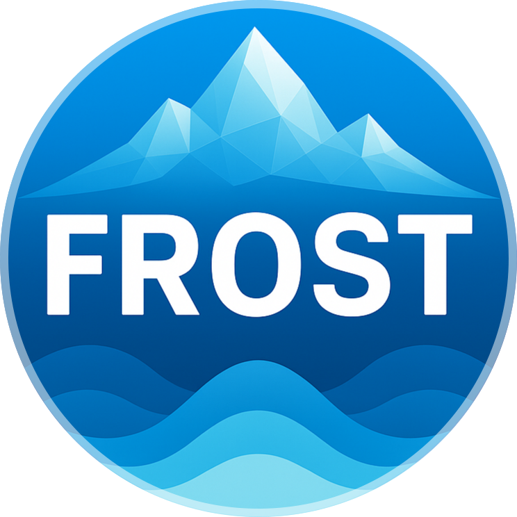
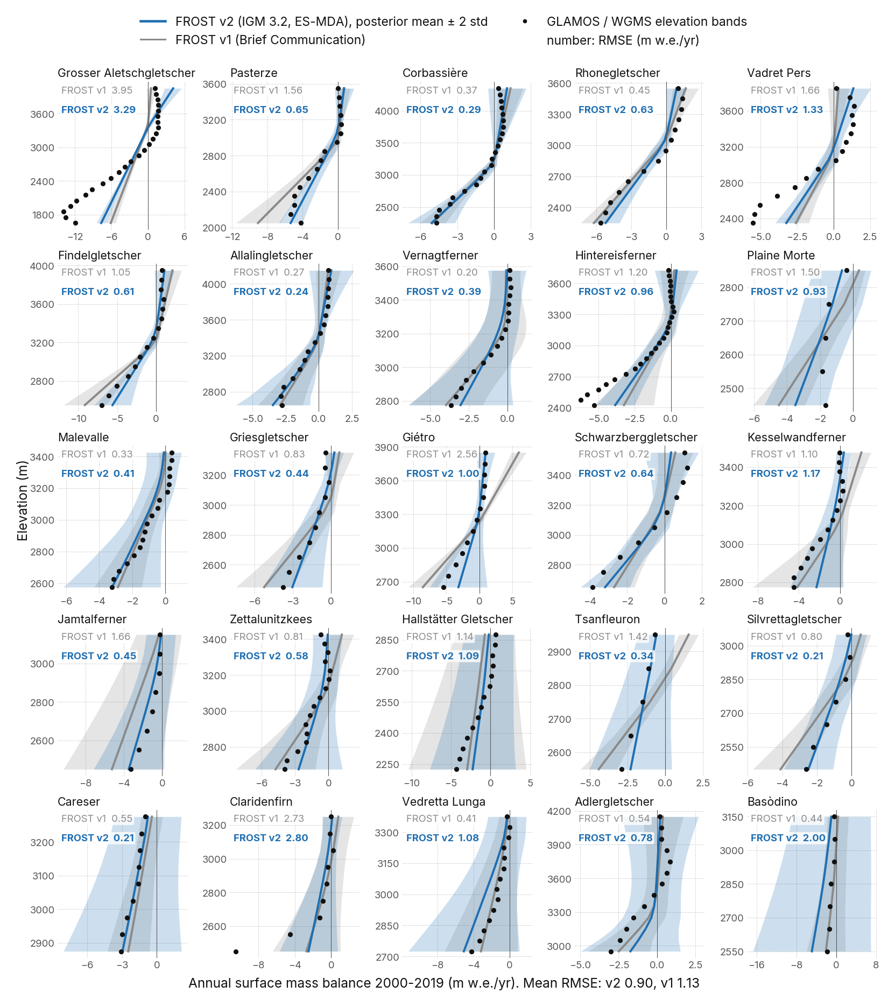
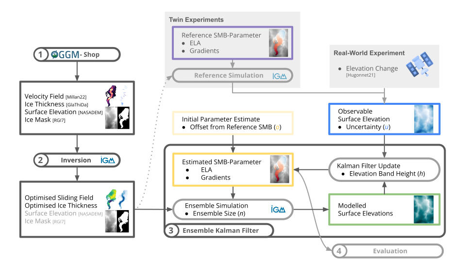
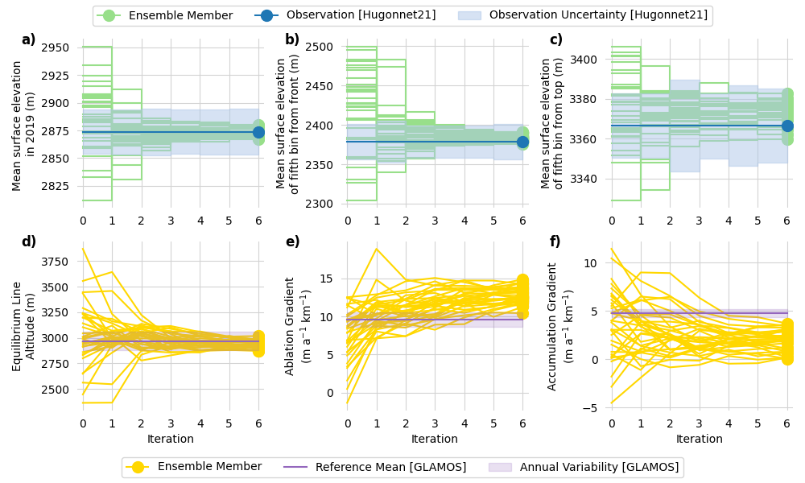
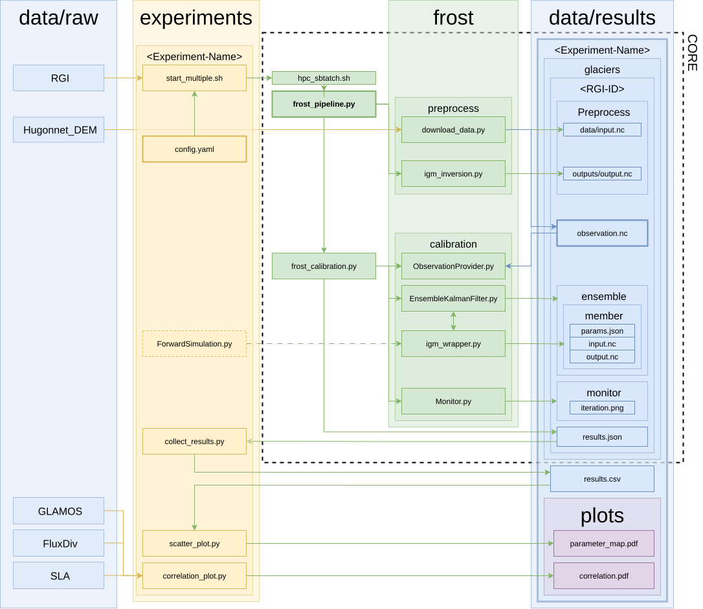

<h1>
  
  <b>F</b>ramework for assimilating <b>R</b>emote-sensing <b>O</b>bservations for <b>S</b>urface
  mass balance <b>T</b>uning<br>
</h1>


FROST is a data assimilation framework for glacier modelling. It couples the
3D glacier model [IGM](https://github.com/instructed-glacier-model/igm) with an
ensemble smoother (ES-MDA) to calibrate glacier-specific surface mass balance
(SMB) parameters against remote-sensing observations of elevation change. The
method is derivative-free and scalable, and it returns the posterior ensemble
of the parameters, so every result comes with its uncertainty. In-situ mass
balance (GLAMOS, WGMS) is used for evaluation only.

---

## ✨ What is new in v2.0

- **IGM 3.2** with the ice-flow emulator retrained on each glacier during the
  forward runs (no start-up speed shock).
- **ES-MDA** (Emerick & Reynolds 2013) instead of the iterated EnKF, so the
  observations count once; seeded, centred perturbed observations.
- **Observation error** of the elevation-band dh/dt from the spatial error
  correlation of Hugonnet et al. (2021), plus a model error per band.
- **Inputs** by default: IceBoost v2.0 ice thickness (moved to 2000 with the
  observed dh/dt) and ITS_LIVE surface velocity; the sliding field (tau_ref)
  is inverted on the geometry of the velocity year.
- **Glaciers without ice flow**: glaciers slower than 5 m/yr (ITS_LIVE 99th
  percentile on the ice) can be calibrated with dh/dt = SMB
  (`EnKF: ice_flow: none`), in milliseconds instead of minutes.
- **SMB models**: the ELA model (ELA and two gradients) and OGGM's monthly
  temperature-index model (melt factor, precipitation factor, temperature
  bias; optionally snow/ice melt factors and a calibrated lapse rate).

Against v1 (the run of the Brief Communication on the ELAs of 25 glaciers
in Central Europe), v2 brings the SMB profiles closer to the GLAMOS / WGMS
elevation-band mass balance: mean RMSE 0.90 instead of 1.13 m w.e./yr, and
88 % instead of 72 % of the bands within the 2-sigma posterior spread.

<picture>
  <source media="(prefers-color-scheme: dark)" srcset="assets/smb_profiles_dark.png">
  
</picture>

*Posterior SMB profiles 2000-2019 of the 25 GLAMOS / WGMS glaciers. Drawn by
`experiments/central_europe_combined_retrain/readme_profiles.py`; the full
evaluation is in `experiments/README.md`.*

Known limitation: the calibration treats ice thickness and sliding as known.
Where the modelled ice flux into the tongue is too small (most clearly on
Grosser Aletschgletscher), the missing emergence is compensated by a flatter
SMB profile. Work on this is in `experiments/inversion_thickness`.

---

## 🏗️ Installation

1. Clone the repository

   ```bash
   git clone git@github.com:FAU-glacier-systems/FROST.git
   ```

2. Create the conda environment and install FROST

   ```bash
   cd FROST
   conda env create -f environment.yml
   conda activate igm32-frost
   pip install -e .
   ```

---

## 🚀 Pipeline for Calibration

1. Copy `experiments/test_default` to a folder for your experiment, e.g.
   `experiments/my_run`, and adapt `pipeline_config.yml`: at least
   `experiment_name` and `rgi_id` (RGI 7.0), and the SMB model and prior.
2. Download the elevation change product of Hugonnet et al. (2021) and set its
   path in `pipeline_config.yml` (`download: hugonnet_directory`, e.g.
   `data/raw/hugonnet/11_rgi60_2000-01-01_2020-01-01`):
   https://www.sedoo.fr/theia-publication-products/?uuid=c428c5b9-df8f-4f86-9b75-e04c778e29b9
3. Run the pipeline (download, inversion, calibration)

   ```bash
   python frost_pipeline.py --config experiments/<experiment-name>/pipeline_config.yml
   ```

   A GPU is recommended for the IGM forward runs; on a Slurm cluster see
   `hpc_sbatch.sh`. An overview of the pipeline:
   

4. View the results:

   * **Calibration results** (posterior ensemble, mean, std, diagnostics):
     `data/results/<experiment-name>/<rgi-id>/calibration_results.json`
   * **Monitor plots** (parameters and fit, prognostic maps):
     `data/results/<experiment-name>/<rgi-id>/Monitor/status.png` and
     `maps_prognostic.png` (with `monitor_plots: all` one file per iteration)
   * **Example**
     

`experiments/README.md` describes the reference setup and every experiment
behind the v2 defaults.

---

## 🏛️ Architecture

A schematic overview of the FROST calibration workflow:


---

## 📎 Reference

If you use FROST, please cite:

Herrmann, O. et al. (2025) ‘A Kalman filter-based framework for assimilating remote sensing observations into a surface
mass balance model’, Annals of Glaciology, 66, p. e23. doi:10.1017/aog.2025.10020.

Data used by default: Hugonnet et al. (2021, Nature 592, 726) elevation
change; IceBoost v2.0 ice thickness (Maffezzoli et al.); ITS_LIVE velocity
(Gardner et al.); RGI 7.0 outlines and W5E5 climate through the OGGM shop.
